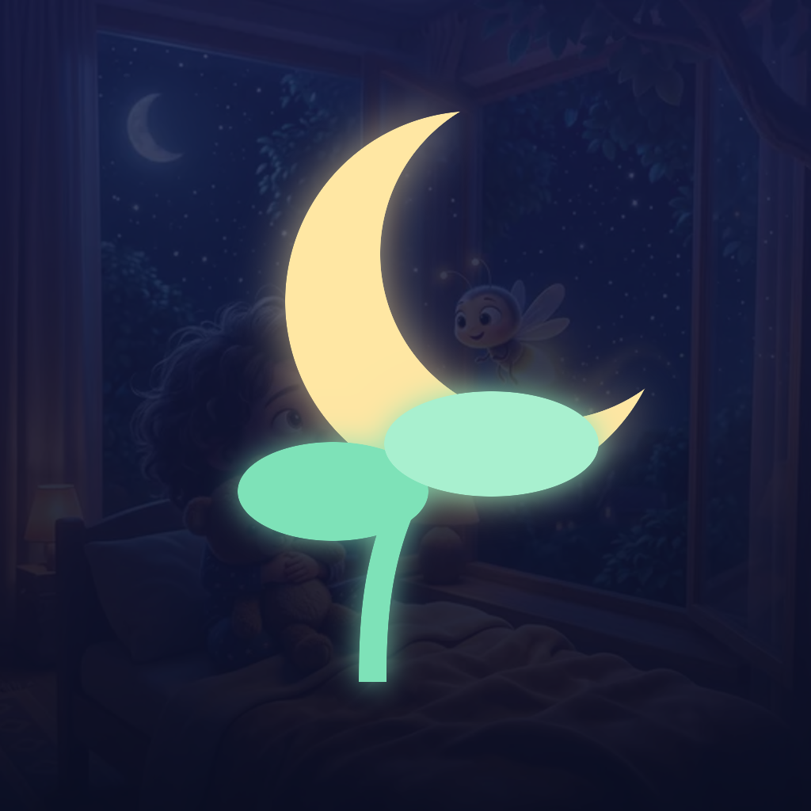
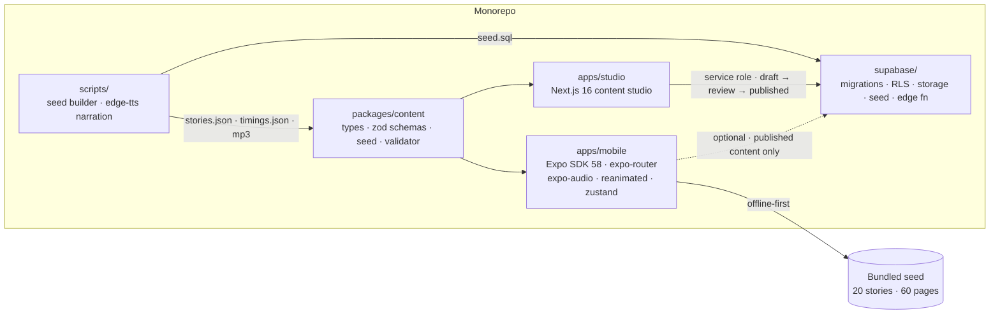

<div align="center">



# DreamSprout Stories

**Narrated, illustrated bedtime stories that read along with your child.**

Expo · React Native · TypeScript · Supabase · Next.js

[](https://github.com/bileldh-ing/DreamSprout/actions/workflows/ci.yml)
[](https://github.com/bileldh-ing/DreamSprout/actions/workflows/supabase.yml)

</div>

---

DreamSprout is a calm, ad-free story app for children aged 3–8. Every page has its own 3D storybook illustration, gentle recorded narration and karaoke-style word highlighting driven by real narration timestamps. Parents get a gated area for profiles, reading defaults, downloads, screen-time limits and a full content-rights list. The app works completely offline from a bundled, rights-cleared library; Supabase is an optional sync layer, and a Next.js studio serves the editorial team.

## Features

**For children**
- 🌙 **Tonight's Pick**: a calm, age-appropriate story that rotates daily, one tap away on the glowing moon button.
- 🗺️ **Story Worlds**: Bedtime, Calm, Animals, Fables, Kindness, Adventure, Magic; search by title, animal or moral.
- 📖 **The Reader**: per-page illustration cross-fade with slow Ken Burns motion, recorded narration, live word highlighting, *tap any word to hear from there*, replay sentence, swipe between pages, auto page-turn.
- 🐢 Speed 0.75× / 1× / 1.25×, subtitles word / sentence / off, and a **Read-myself** mode.
- 😴 **Sleep timer** (end of page, 5–20 min) with a soft volume fade into a Goodnight screen.
- ❤️ Favorites, continue reading, and The End screen with the story's moral and a next pick.

**For parents** (behind a parental gate)
- Child profiles with **nickname + age band only**, several children per device.
- Reading defaults, bedtime dim mode, reduced motion, English / Français interface.
- Downloads manager, daily screen-time limit, privacy & safety (delete all data), content rights list.

**Built for kids' stores**
- No ads, tracking, purchases, social features, external links or dangerous permissions.
- 44 pt touch targets, accessibility labels, reduced-motion support, high-contrast reading panel.

## Screenshots

> Screenshots and a demo video will be added here. Record them from the web build: `npm run mobile:web`, then `npx serve apps/mobile/dist --single -l 8081`.

| Home | Story details | Reader | Parents |
|---|---|---|---|
| _coming soon_ | _coming soon_ | _coming soon_ | _coming soon_ |

## Architecture



See [docs/ARCHITECTURE.md](docs/ARCHITECTURE.md) for the player state machine, the sync model and the data design.

## Quick start

Requirements: Node 22 (see `.nvmrc`) and npm 10+. Optional: Supabase CLI, Python 3.11 + ffmpeg for narration.

```bash
git clone https://github.com/bileldh-ing/DreamSprout.git && cd DreamSprout
npm install

# mobile app
cd apps/mobile && npx expo start          # press i / a / w

# web build of the app (screenshots / demo video)
npm run mobile:web                         # → apps/mobile/dist
npx serve apps/mobile/dist --single -l 8081

# content studio
npm run dev -w @dreamsprout/studio         # http://localhost:3001

# optional local backend
supabase start                             # applies migrations + supabase/seed.sql
```

## Environment variables

Copy `.env.example`. Everything is optional: without Supabase, the app and the studio run from the bundled seed.

| Variable | Where | Purpose |
|---|---|---|
| `EXPO_PUBLIC_SUPABASE_URL`, `EXPO_PUBLIC_SUPABASE_ANON_KEY` | mobile | Optional sync of published stories |
| `EAS_PROJECT_ID`, `EXPO_OWNER` | mobile / CI | EAS project and OTA updates |
| `SUPABASE_URL`, `SUPABASE_SERVICE_ROLE_KEY` | studio (server only) | Studio reads/writes Supabase |
| `STUDIO_BASIC_AUTH` | studio | Optional `user:password` protection |

GitHub secrets used by the workflows: `EXPO_TOKEN`, `GOOGLE_PLAY_SERVICE_ACCOUNT_JSON`, `EXPO_APPLE_APP_SPECIFIC_PASSWORD`, `SUPABASE_ACCESS_TOKEN`, `SUPABASE_DB_PASSWORD`; variables `EAS_PROJECT_ID`, `SUPABASE_PROJECT_REF`, `EXPO_PUBLIC_SUPABASE_URL`, `EXPO_PUBLIC_SUPABASE_ANON_KEY`. Every workflow that needs one skips with a notice when it is missing.

## Scripts

| Command | What it does |
|---|---|
| `npm run lint` / `format` / `format:check` | ESLint (flat config) and Prettier |
| `npm run typecheck` | `tsc --noEmit` in every workspace |
| `npm test` / `npm run test:coverage` | Jest (jest-expo + React Native Testing Library) for mobile, Vitest for content and studio |
| `npm run validate:content` | Fails if a story lacks a source/licence, a page lacks an image/audio, or timings are missing |
| `npm run seed:build` | Regenerates `supabase/seed.sql` and the mobile asset map from `packages/content/data` |
| `npm run mobile:web` | `expo export -p web` → `apps/mobile/dist` |
| `npm run studio:build` | `next build` for the studio |
| `python scripts/tts/generate_narration.py` | Regenerates narration MP3s + word timings with edge-tts |
| `bash scripts/generate-icons.sh` | Rebuilds the app icon, adaptive icon, splash and favicon |

## Repository layout

```
apps/mobile      Expo app (src/app = routes, src/features = player / parents / downloads logic)
apps/studio      Next.js content studio
packages/content Shared story types, schemas, seed data, validator
supabase         Migrations, RLS, storage, seed.sql, SQL tests, edge function
scripts          Seed builder, TTS narration generator, icon generator
.maestro         End-to-end flows (manual CI workflow)
docs             Architecture, release checklist, content rights
```

## Docs

[Architecture](docs/ARCHITECTURE.md) · [Release checklist](docs/RELEASE.md) · [Content rights](docs/CONTENT_RIGHTS.md) · [Privacy](PRIVACY.md) · [Changelog](CHANGELOG.md)

## License

Code: [MIT](LICENSE). Story texts, illustrations and narration are © DreamSprout and are not MIT-licensed; see [docs/CONTENT_RIGHTS.md](docs/CONTENT_RIGHTS.md).
