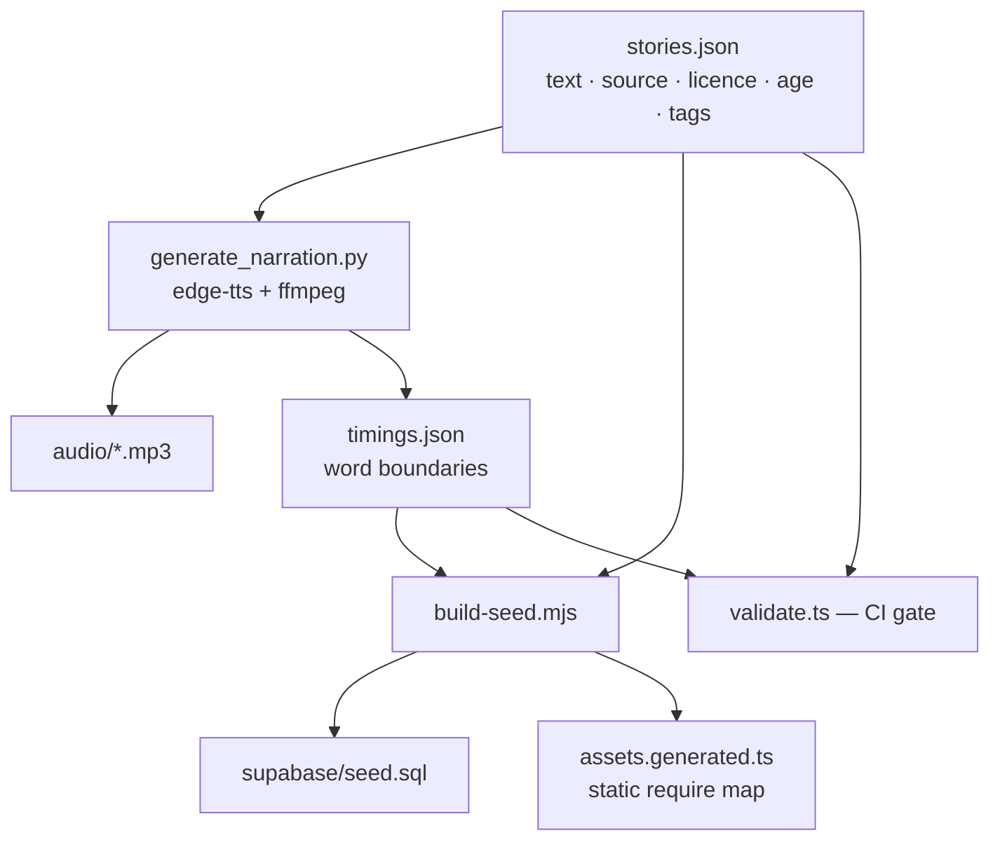

# Architecture

## Overview

DreamSprout is an npm-workspaces monorepo.

| Package | Role |
|---|---|
| `apps/mobile` | Expo SDK 58 app (managed workflow, expo-router, TypeScript strict). Runs on iOS, Android and web. |
| `apps/studio` | Next.js 16 (App Router) editorial studio. |
| `packages/content` | Shared `Story` / `StoryPage` / `WordTiming` types, zod schemas, discovery helpers (`filterStories`, `tonightsPick`) and `validateLibrary`. Holds the canonical seed (`data/stories.json`, `data/timings.json`). |
| `supabase` | Postgres schema, RLS, storage buckets, publish gate, audit log, generated seed, SQL tests and an edge-function stub. |
| `scripts` | `build-seed.mjs` (seed.sql + Metro asset map), `tts/generate_narration.py` (edge-tts), `generate-icons.sh`. |

## Content pipeline



Word timings are the real word-boundary events emitted by the TTS stream; nothing is interpolated. The studio shows "alignment unfinished" for a page with no timings and refuses to publish it.

## Mobile app

### Navigation (`src/app`)

```
_layout.tsx            providers, hydration gate, screen-time guard, bedtime dim overlay
(tabs)/_layout.tsx     custom floating glass tab bar + glowing "Tonight" button
(tabs)/index.tsx       Home: Tonight's Pick, Story Worlds, Continue reading, search, grid
(tabs)/library.tsx     age-band filter
(tabs)/favorites.tsx
onboarding.tsx         welcome + first child profile (nickname, age band)
story/[id].tsx         details: cover, chips, stats, synopsis, moral, rights, Preview / Read Book
reader/[id].tsx        the player
end/[id].tsx           The End + moral + next pick
goodnight.tsx          sleep-timer / screen-limit destination
parent-gate.tsx        multiplication gate with lockout
parents/*              profiles, reading, downloads, screen time, privacy, rights (session-gated layout)
```

### Player

- **Authoritative clock**: `expo-audio`'s `currentTime` (100 ms status updates). No JS timer drives highlighting.
- **Sync** (`features/player/timing.ts`): `tokenize()` aligns display tokens (with punctuation) to timing words with a short look-ahead and never invents a timing; `findWordIndex()` binary-searches the active word; `seekTimeForToken()` powers tap-to-seek; `sentenceStart()` powers replay-sentence.
- **Rendering**: each word is a memoised `<Text>` span, so a tick re-renders only the spans whose state changed.
- **State machine** (`features/player/machine.ts`): `loading → ready/playing ⇄ paused`, `seeking`, `buffering`, `page_transition`, `audio_ended`, `media_error`, `story_completed`, `disposed`. It prevents overlapping playback during page transitions; audio pauses when the screen loses focus.
- **Sleep timer** (`features/player/sleep-timer.ts`): a pure function of `(setting, startedAt, now)` returning a volume multiplier (linear fade over the last 30 s) and `expired`.
- **Motion**: Reanimated Ken Burns plus an expo-image cross-dissolve, disabled when the OS or a parent asks for reduced motion.

### State

`zustand` + `persist` (AsyncStorage, localStorage on web): profiles, per-profile favorites and progress (throttled 5 s writes), settings, downloads and daily screen time. The parent-gate session lives in memory only (10 minutes).

### Offline & sync

The 20 seed stories (60 illustrations, 60 MP3s, about 6.6 MB) are bundled. `lib/catalog.ts` uses TanStack Query with the seed as `initialData`; when Supabase env vars are present it fetches **published** stories, validates every row with the shared zod schema and merges them over the seed. Any error falls back to the seed. The downloads manager copies media into the document directory (`expo-file-system`) so it survives cache eviction.

## Backend (Supabase)

Tables: `profiles` (adults; role `parent | studio | admin`), `content_licenses`, `stories`, `story_pages` (text + `word_timings` jsonb), `assets`, `rights_checklist`, `child_profiles`, `favorites`, `reading_progress`, `audit_log`.

- **RLS**: published content is public-read; `studio`/`admin` roles write content; parents CRUD only their own children and their favorites/progress; the audit log is studio-read-only.
- **Publish gate** trigger: moving `stories.status` to `published` raises unless the rights checklist is complete and every page has an image, audio and non-empty timings. The studio enforces the same rule client- and server-side.
- **Audit**: triggers log every insert/update/delete on stories and licences with the actor.
- **Storage**: public-read `illustrations` and `narration` buckets; uploads limited to the studio role.
- **Edge function** `generate-narration`: authenticates a studio user and queues a TTS job (recorded in `audit_log`) for the media worker / `generate_narration.py`.
- **Tests**: `supabase/tests/rls_and_rights.sql` checks the seed, the publish gate, the audit log and RLS for anonymous and parent users.

## Studio

Server components read through `lib/repo.ts` (Supabase with the service-role key when configured, otherwise a local JSON store seeded from the bundled library). `lib/workflow.ts` defines the transitions `draft → review → published → archived/draft` and runs the shared validator plus the rights checklist before review and publish. Optional basic auth lives in `src/proxy.ts`; production should use SSO or Supabase Auth with the studio role.

## Quality gates

ESLint + Prettier + `tsc` in every workspace; Jest (jest-expo, React Native Testing Library) for player sync, parent gate, sleep timer, state machine, store, catalog merge, i18n parity and components; Vitest for content validation and the studio workflow; SQL integration tests for RLS and the publish gate; Maestro flows for home → story → read → end.
